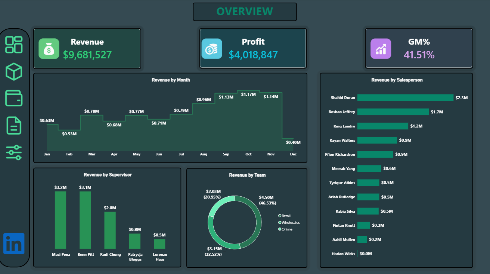
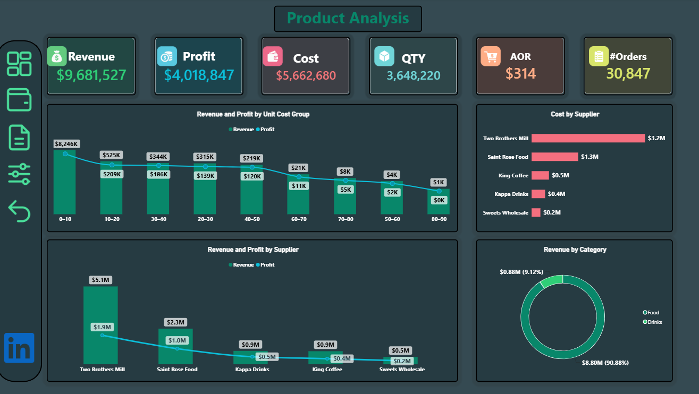
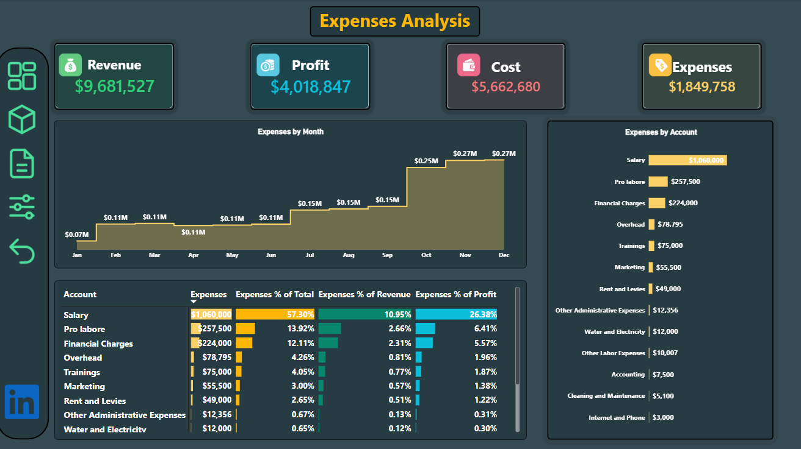
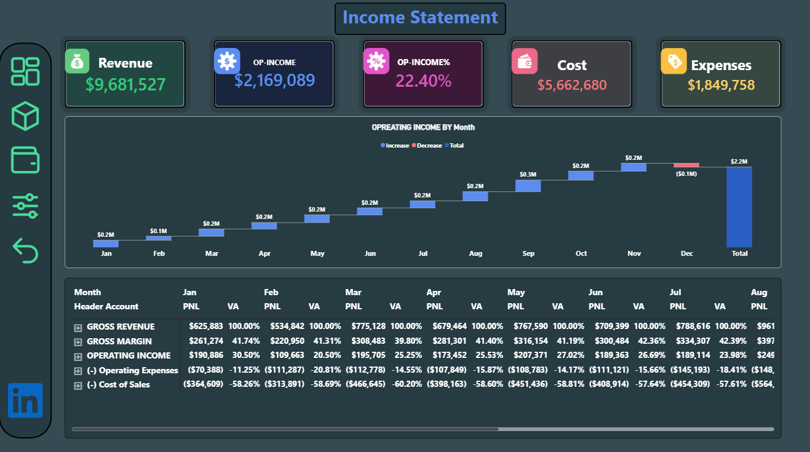
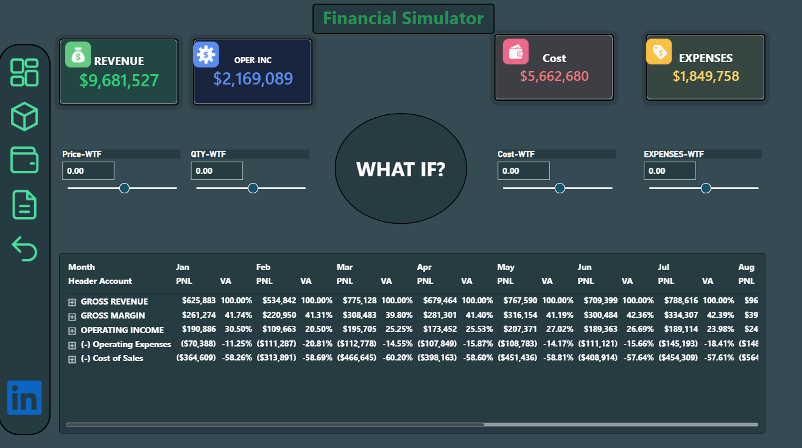

# Finance & Sales Analytics Dashboard

An interactive Power BI report for exploring sales performance, product and supplier results, operating expenses, and financial statement trends. The report contains five pages, including a What-If financial simulator.

## Dashboard preview

### Overview

### Product analysis

### Expenses analysis

### Income statement

### Financial simulator

## Business questions

- What are the report's headline revenue, profit, and gross margin figures?
- How does revenue change across the months shown?
- Which salespeople, supervisors, and teams contribute the most revenue?
- How do revenue and profit compare across unit-cost groups, suppliers, and product categories?
- Which expense accounts make up the largest share of operating expenses?
- How do operating expenses change by month, and what monthly changes in operating income are visible?
- What financial outputs can be explored using the simulator's What-If controls?

## Key insights

- The Overview reports **$9,681,527** in revenue, **$4,018,847** in profit, and a **41.51%** gross margin.
- Monthly revenue reaches its highest displayed level in **October (about $1.17M)**, then decreases to about **$1.14M in November** and **$0.40M in December**.
- **Shahid Duran** has the highest displayed revenue by salesperson, at about **$2.3M**. Among supervisors, **Madi Pena** is highest at about **$3.2M**.
- Retail is the largest team by revenue at **$4.50M (46.53%)**, followed by Wholesales at **$3.15M (32.52%)** and Online at **$2.03M (20.95%)**.
- The Product Analysis page's **unit-cost-group** chart shows the **$0–10** group with the highest displayed revenue. The chart groups products by unit cost, not selling price.
- **Two Brothers Mill** has the highest displayed supplier revenue (about **$5.1M**) and cost (about **$3.2M**). Food accounts for **90.88%** of revenue by category, compared with **9.12%** for Drinks.
- Salary is the largest listed expense account at **$1,060,000**, or **57.30%** of operating expenses. Total operating expenses are **$1,849,758**.
- The Income Statement page reports operating income of **$2,169,089 (22.40%)**. Its waterfall shows a negative monthly change in December; the screenshot alone does not establish the cause.

The figures above are transcribed from the supplied dashboard screenshots. Values shown in chart labels are rounded; the report's underlying values may be more precise.

## Report pages

- **Overview:** headline measures and revenue by month, salesperson, supervisor, and team.
- **Product Analysis:** revenue and profit by unit-cost group and supplier, cost by supplier, revenue by category, and headline sales measures.
- **Expenses Analysis:** monthly expenses, expenses by account, and expense comparisons with total expenses, revenue, and profit.
- **Income Statement:** revenue, cost, expenses, operating income, monthly operating-income changes, and a monthly account matrix with P&L and vertical analysis (VA).
- **Financial Simulator:** What-If input controls for price, quantity, cost, and expenses, alongside financial measures and a monthly P&L/VA matrix. The screenshots show the controls at their initial values, so no scenario result is claimed here.

## Project workflow and tools

The report was created in Power BI Desktop using Excel source workbooks, Power Query for data preparation, and DAX for report calculations and measures.

## Files

- `Sales & Finance Project .pbix` — Power BI report file.
- PNG files in this repository — dashboard screenshots shown above.

## Open the report

Download the `.pbix` file and open it with Power BI Desktop to explore the interactive report pages.

## Tools

- Power BI Desktop
- Power Query
- DAX
- Microsoft Excel
